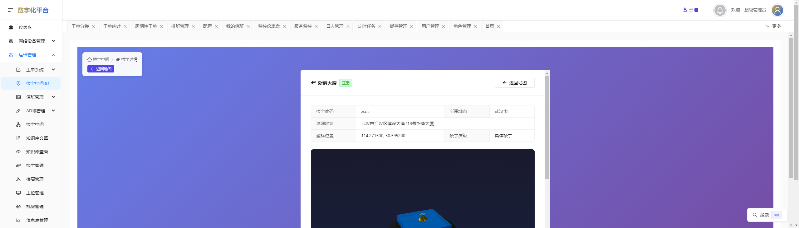

# RuoYi-Next 企业级权限管理系统



## 项目简介

RuoYi-Next是基于若依(RuoYi)开源管理系统的全新重构版本，采用Go语言和React技术栈构建的企业级权限管理系统。项目旨在解决原有系统的技术债务问题，提供更高性能、更易扩展的管理系统解决方案。

## 功能特性

- **用户管理**：用户CRUD、状态管理、权限分配
- **角色管理**：基于RBAC模型的权限控制
- **菜单管理**：动态菜单配置、按钮级权限
- **部门管理**：多级组织结构管理
- **系统监控**：服务器资源、缓存状态监控
- **定时任务**：可视化任务调度
- **代码生成**：前后端代码一键生成
- **安全认证**：JWT认证、国密算法支持

## 技术栈

### 后端技术
- **编程语言**: Go 1.23+
- **Web框架**: Gin 1.9+
- **数据库**: PostgreSQL 18.1+ / SQLite
- **ORM**: GORM 1.25+
- **缓存**: Redis 7.4+
- **认证**: JWT + 国密算法(tjfoc/gmsm)
- **文档**: Swagger (swaggo/swag)

### 前端技术
- **框架**: React 19.2+ + TypeScript 5.9+
- **状态管理**: Zustand 5.0+
- **UI组件**: Ant Design 5.21+
- **构建工具**: Vite 6.0+
- **CSS框架**: Tailwind CSS 3.4+

## 项目结构

```
ruoyi-go-backend/
├── cmd/              # 应用入口(main.go)
├── configs/          # 配置文件
├── internal/         # 核心代码
│   ├── api/          # API接口层
│   ├── core/         # 核心业务逻辑
│   ├── services/     # 业务服务
│   └── models/       # 数据模型
├── pkg/              # 公共库
├── scripts/          # 构建和部署脚本
├── docs/             # 项目文档
└── ruoyi-react-frontend/  # 前端项目
```

## 快速开始

### 环境要求
- Go 1.23+
- PostgreSQL 18.1+ 或 SQLite
- Redis 7.4+
- Node.js 24.12+ (前端)

### 后端启动
1. 复制配置文件：
```bash
cp configs/config.dev.yaml configs/config.yaml
```

2. 修改配置文件中数据库和Redis连接信息

3. 安装依赖并运行：
```bash
go mod tidy
go run cmd/main.go
```

### 前端启动
```bash
cd ruoyi-react-frontend
npm install
npm run dev
```

## 配置说明

主要配置项(`configs/config.yaml`)：

```yaml
server:
  mode: "debug"  # 运行模式: debug/release/test
  port: 8080     # 服务端口

database:
  type: "postgres"  # 数据库类型: postgres/sqlite
  host: "localhost"
  port: 5432
  username: "ruoyi"
  password: "ruoyi123"
  dbname: "ruoyi_next"

redis:
  host: "localhost"
  port: 6379
  password: ""
  db: 0

jwt:
  secret: "ruoyi-next-secret"
  expire: 7200  # token过期时间(秒)
```

## API文档

项目集成Swagger文档，启动服务后访问：
```
http://localhost:8080/swagger/index.html
```

## 部署说明

### 生产环境部署
1. 使用生产配置：
```bash
cp configs/config.prod.yaml configs/config.yaml
```

2. 构建可执行文件：
```bash
go build -o ruoyi-next cmd/main.go
```

3. 使用脚本部署：
```bash
scripts/build_and_deploy.bat
```

### Docker部署
```bash
docker-compose up -d
```

## 贡献指南

1. Fork项目仓库
2. 创建特性分支(`git checkout -b feature/your-feature`)
3. 提交更改(`git commit -am 'Add some feature'`)
4. 推送到分支(`git push origin feature/your-feature`)
5. 创建Pull Request

## 许可证

MIT License

Copyright (c) 2024 RuoYi-Next Team