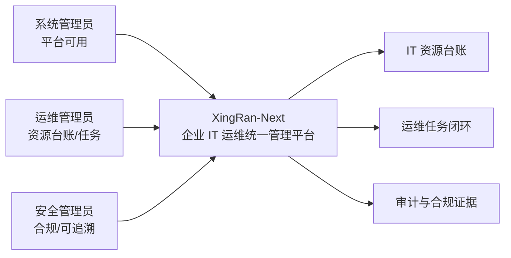
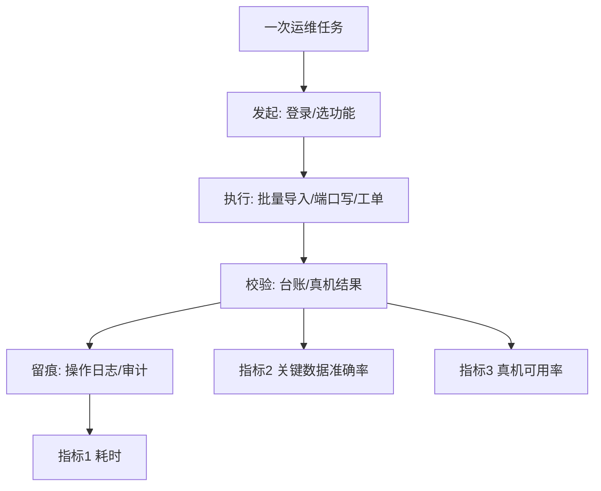
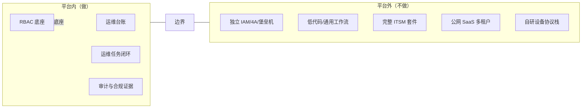

# XingRan-Next 产品定义（一页纸）

> 本文件是产品定位、角色与成功指标的**唯一权威说明**。技术架构见 [`architecture/项目概述和架构设计.md`](architecture/项目概述和架构设计.md)，完整文档地图见 [`docs/README.md`](README.md)。

## 一句话定位

**XingRan-Next 是企业 IT 运维统一管理平台**——把楼宇/工位/资产、网络设备、AD 域账号、VDI 桌面、工单值班、监控告警与操作审计收敛到一个平台，让运维任务可批量、可追溯、可度量。

> ⚠️ 它不是「权限管理系统」。RBAC（用户/角色/菜单/部门）只是平台的底座能力之一，不是产品定位；本平台也不替代专业的 IAM / 4A / 堡垒机产品。

## 三类角色与核心任务

| 角色 | 关注目标 | 核心任务 | 典型入口 |
|------|----------|----------|----------|
| **系统管理员** | 平台本身可用、账号与配置正确 | 用户/角色/菜单/部门/岗位/字典/参数维护；AD 域对接与服务账号池；定时任务、通知与知识库配置；系统参数与加密开关 | 系统管理、参数管理、定时任务 |
| **运维管理员** | IT 资源台账准确、日常运维高效 | 楼宇/楼层/工位/机房/资产台账与 Excel 批量导入导出；网络设备纳管、命令模板、端口采集与端口写；工单轮转、值班排班、VDI 虚拟机生命周期 | 运维管理、网络设备、工单/值班 |
| **安全管理员** | 操作合规、风险可控、可追溯 | 权限边界与最小授权审阅；SM2/SM3/SM4 国密与请求/响应加密策略；操作日志与端口写审计核查；密钥/凭据轮转与泄漏处置 | 安全审计、操作日志、缓存/密钥管理 |

## 三个可量化成功指标

| # | 指标 | 定义（口径） | 目标 | 度量方式 |
|---|------|--------------|------|----------|
| 1 | **管理员独立完成一次运维任务耗时** | 从登录到完成一次典型任务（如：批量导入 100 条工位并关联部门/用户，或单台交换机端口写）且无需研发介入的端到端耗时 | ≤ 10 分钟（P80），较线下/脚本方式下降 ≥ 50% | 操作日志起止时间 + 现场计时抽样 |
| 2 | **关键数据准确率** | 工位/资产/网络设备/端口/AD 账号等关键台账中，与真机或权威源一致且字段完整的记录占比 | ≥ 99% | 定期抽样核对 + 对账任务差异率 |
| 3 | **现场真机功能可用率** | 在客户现场真实设备型号上，已交付功能中可正常执行且结果符合预期的比例 | ≥ 95% | 真机 UAT 用例通过数 / 应执行用例总数 |

> 指标 2、3 强调「真机 / 权威源」而非模拟数据：命令模板、端口写、采集解析等能力必须以现场型号取证为准，未取证项不得计入可用率分子。

## 明确「不做什么」（边界）

| 不做 | 原因 / 边界说明 |
|------|------------------|
| **不做通用权限管理系统 / IAM / 4A / 堡垒机** | RBAC 只是平台底座；不提供独立 IAM 产品形态、不替代堡垒机的会话代理与录屏 |
| **不做通用低代码 / 表单引擎 / 工作流引擎** | 工单与值班是固定业务模型，不提供用户自定义流程编排与任意表单建模 |
| **不做 CMDB 之外的通用 ITIL / ITSM 全套件** | 聚焦运维台账与任务闭环，不覆盖变更/发布/服务目录/财务等完整 ITSM 流程 |
| **不做面向公网的 SaaS 多租户产品** | 定位为企业内网私有化部署；不提供自助注册、按租户计费与公网多租户隔离 |
| **不做设备固件/网络协议栈自研** | 通过 Scrapli / SNMP / TextFSM 对接现网设备，不实现交换机操作系统或私有协议栈 |
| **不承诺未真机取证的功能可用** | 命令模板与物理参数按厂商文档实现，现场型号差异需真机 UAT 取证后才计入交付可用率 |
| **不把演示/模拟数据当作验收依据** | 关键数据准确率与真机可用率均以现场真机/权威源为准 |

## 与其他文档的关系

- 定位、角色与指标：本文件（权威）
- 管理员操作与故障排查：[`管理员使用手册.md`](管理员使用手册.md)（归 A1 维护，本任务不改写）
- 错误码与 FAQ 索引：[`guides/错误码速查.md`](guides/错误码速查.md)、[`guides/FAQ-索引.md`](guides/FAQ-索引.md)
- 技术架构与目录：[`README.md`](../README.md)、[`architecture/`](architecture/)、[`guides/`](guides/)
