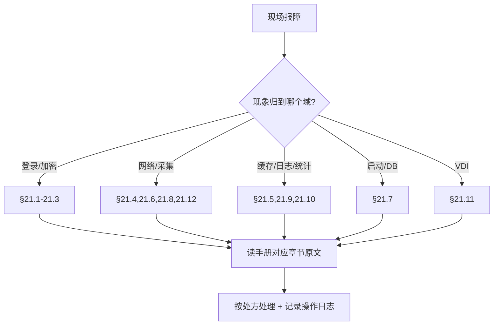

# FAQ 索引（对应管理员使用手册 §21）

> 本文件是从 [`../管理员使用手册.md`](../管理员使用手册.md) §21「常见问题与故障排查」**摘列的索引与导读**，不重写手册、不新增结论。每条给出「现象 → 手册章节 → 一句话要点」，排查时请先读手册原文。手册归 A1 维护，本索引只做导航。

## 12 条 FAQ 一览（表格化）

| # | 现象（摘自手册 §21） | 章节 | 一句话要点 |
|---|----------------------|------|------------|
| 1 | 登录失败，提示 admin_bind / LDAP data 775 | [§21.1](../管理员使用手册.md) | 优先查 AD 账号锁定 / 服务账号池熔断 / SM4 解密偶发失败 |
| 2 | 登录后 idle 一段时间报加密错误、被强制登出 | [§21.2](../管理员使用手册.md) | 前后端加密开关不一致，核对 `sys.request.encryption.enabled` 与 `security.request_encryption.*` |
| 3 | 登录页既不弹验证码也没有输入框（死状态） | [§21.3](../管理员使用手册.md) | 验证码类型配了非法值（仅 `disabled/normal/slider`） |
| 4 | 网络设备采集间歇性失败（设备较多时） | [§21.4](../管理员使用手册.md) | SSH 连接池打满，调 `network.connection_pool.*` 后需重启 |
| 5 | RPA 心跳刷屏操作日志 | [§21.5](../管理员使用手册.md) | 用 `operlog.exclude_paths` 排除高频路径 |
| 6 | 设备序列号/信息不更新 | [§21.6](../管理员使用手册.md) | `device_info_update` 任务默认暂停；清理僵尸 `running` 任务 |
| 7 | 启动卡在「PostgreSQL 连接成功」无 migration 日志 | [§21.7](../管理员使用手册.md) | 僵尸 MV 刷新锁死，`pg_terminate_backend` 后重启 |
| 8 | MAC 地址格式不一致 | [§21.8](../管理员使用手册.md) | 已全链路归一化为 `AA:BB:CC:DD:EE:FF`，先查部署二进制版本一致 |
| 9 | 统计卡片数字偏小（如恰好 100） | [§21.9](../管理员使用手册.md) | 误用列表接口被 MaxPageSize 钳制，应走专用 COUNT/statistics 端点 |
| 10 | 缓存监控里键名带 `xingran:` 前缀 | [§21.10](../管理员使用手册.md) | 系统自动剥离前缀，直接粘贴即可 |
| 11 | VDI 虚拟机按钮置灰 | [§21.11](../管理员使用手册.md) | `power_state` 合法值仅 `pending/stopped/suspended/in_use` |
| 12 | 端口列表看到「跨设备同名接口」 | [§21.12](../管理员使用手册.md) | 正常现象，物理链路以 `port_id`(UUID) 锚定 |

## 按域分组（表格化界面/流程）

| 域 | 相关 FAQ | 常用入口 |
|----|----------|----------|
| 登录 / 认证 / 加密 | §21.1、§21.2、§21.3 | 登录页、参数管理、AD 域 → 服务账号池 |
| 网络设备 / 采集 | §21.4、§21.6、§21.8、§21.12 | 网络设备、定时任务、端口列表 |
| 缓存 / 日志 / 统计 | §21.5、§21.9、§21.10 | 缓存监控、操作日志、仪表盘 |
| 启动 / 数据库 | §21.7 | 部署与运维、`pg_stat_activity` |
| VDI / 桌面云 | §21.11 | 虚拟机管理 |

## 相邻索引

- 错误码可读说明：[`错误码速查.md`](错误码速查.md)
- 完整文档地图：[`../README.md`](../README.md)
- 产品定位与边界：[`../PRODUCT.md`](../PRODUCT.md)
- 手册权威原文：[`../管理员使用手册.md`](../管理员使用手册.md)（本任务不改写）
