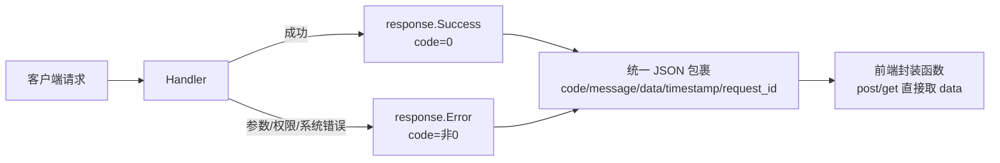
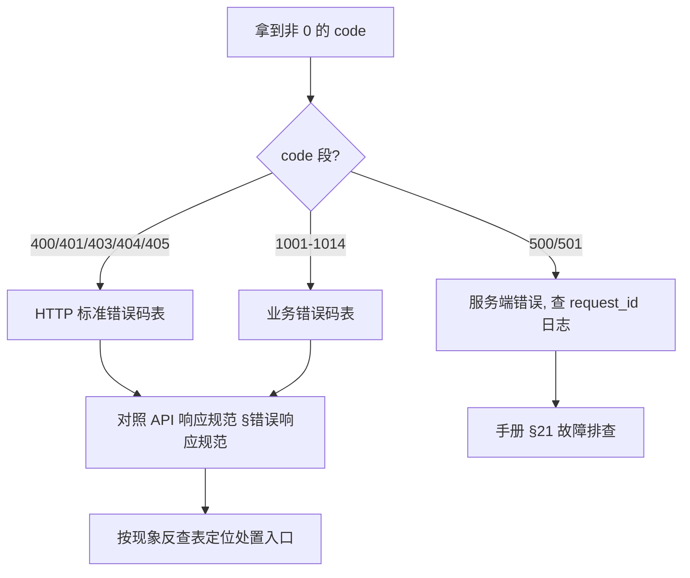

# 错误码速查（可读说明索引）

> 本文件只是**索引与导读**，不重写权威文档：错误码的完整定义、示例与前端处理约定以 [`../standards/API响应规范.md`](../standards/API响应规范.md) §错误响应规范 为唯一真相源；统一错误处理的落地说明见 [`../archive/统一错误处理实施总结.md`](../archive/统一错误处理实施总结.md)；管理员侧排查见 [`../管理员使用手册.md`](../管理员使用手册.md) §21。

## 响应里 code 放在哪

| 字段 | 含义 | 成功值 |
|------|------|--------|
| `code` | 业务状态码 | `0` |
| `message` | 可读提示 | `success` |
| `data` | 业务数据 | 对象 / 列表 / null |
| `timestamp` | 服务端时间戳 | 秒级整数 |
| `request_id` | 链路追踪 ID | uuid 字符串 |

## HTTP 标准错误码（摘自 API 响应规范 §错误状态码分类）

| code | 含义 | 常见触发 |
|------|------|----------|
| `400` | 请求参数错误 | 参数绑定失败、字段校验不通过 |
| `401` | 未授权访问 | 未携带 / 携带失效 Access Token |
| `403` | 权限不足 | RBAC 权限点缺失、跨模块选择器 403 |
| `404` | 资源不存在 | 路由或记录 ID 不存在 |
| `405` | 请求方法不允许 | 用错 HTTP 方法 |
| `500` | 服务器内部错误 | 服务层返回 error，Handler 统一映射 |
| `501` | 服务未实现 | 端点占位未实现 |

## 业务错误码（摘自 API 响应规范 §错误状态码分类）

| code | 含义 | code | 含义 |
|------|------|------|------|
| `1001` | 参数错误 | `1008` | 令牌尚未生效 |
| `1002` | 用户不存在 | `1009` | 数据已存在 |
| `1003` | 密码错误 | `1010` | 数据不存在 |
| `1004` | 用户已禁用 | `1011` | 密码哈希格式不支持 |
| `1005` | 验证码错误 | `1012` | 密码解析失败 |
| `1006` | 令牌已过期 | `1013` | 用户名或密码错误 |
| `1007` | 令牌无效 | `1014` | 数据库操作失败 |

> 端口写命令相关的 sentinel 错误（如 VLAN 越界、MAC/IP 格式不合法）见 API 响应规范 §v1.20.1 扩展 小节，不在本表重复列出。

## 按现象反查（表格化流程）

| 现象 | 优先看的 code | 处置入口 |
|------|---------------|----------|
| 登录报「用户名或密码错误」 | `1013` / `1003` / `1004` | 手册 §21.1（AD data 775 / 服务账号池） |
| 登录后 idle 报加密错误 | `400` / `401` | 手册 §21.2（前后端加密开关一致性） |
| 列表/选择器 403 | `403` | [`../standards/跨模块选择器权限处理规范.md`](../standards/跨模块选择器权限处理规范.md) |
| 令牌过期 / 无效 | `1006` / `1007` | 前端 `authStore` 自动刷新；仍失败见手册 §21.2 |
| 端口写参数被拒 | `400` | API 响应规范 §v1.20.1 扩展（4 个 sentinel 错误） |

## 不重复声明

- 错误码数值、顺序、示例 JSON：**以** [`../standards/API响应规范.md`](../standards/API响应规范.md) **为准**。
- 前端不要裸用 axios 判 `code`，使用封装函数（见 API 响应规范 §前端调用规范）。
- 历史归档（[`../archive/统一错误处理实施总结.md`](../archive/统一错误处理实施总结.md)）保留原文，本索引不改动它。
