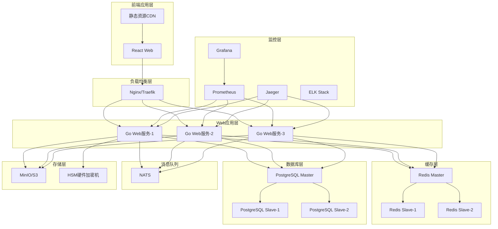

# 部署和运维文档

## 1. 部署架构概述

### 1.1 部署架构图



### 1.2 环境规划

| 环境 | 用途 | 配置 | 数据 |
|------|------|------|------|
| **开发环境** | 功能开发和调试 | 2核4G，单机部署 | 测试数据 |
| **测试环境** | 功能测试和集成测试 | 4核8G，单机部署 | 测试数据 |
| **预生产环境** | 上线前验证 | 8核16G，2节点 | 生产数据备份 |
| **生产环境** | 正式运行环境 | 16核32G，3+节点 | 生产数据 |

### 1.3 部署方式

- **容器化部署**：Docker + Docker Compose（开发/测试）
- **容器编排**：Kubernetes（生产）
- **传统部署**：Systemd服务（特定场景）
- **云原生部署**：Helm Charts + 云服务

## 2. 环境准备

### 2.1 系统要求

#### 2.1.1 最低配置

```yaml
# 开发环境
development:
  cpu: 2 cores
  memory: 4 GB RAM
  disk: 50 GB SSD
  os: Linux (Ubuntu 20.04+ / CentOS 8+)

# 生产环境（每节点）
production:
  cpu: 8 cores minimum (16 recommended)
  memory: 16 GB RAM minimum (32 GB recommended)
  disk: 100 GB SSD minimum (500 GB recommended)
  os: Linux (CentOS 8+ / RHEL 8+ / Ubuntu 20.04+)
  network: Gigabit Ethernet minimum
```

#### 2.1.2 软件依赖

```bash
# 基础软件
- Docker 20.10+
- Docker Compose 2.0+
- Kubernetes 1.24+ (生产)
- Helm 3.8+ (Kubernetes部署)

# 数据库
- PostgreSQL 15+
- Redis 7.0+
- NATS 2.9+

# 运维工具
- Git 2.30+
- Make 4.2+
- OpenSSL 1.1.1+
```

### 2.2 环境安装脚本

#### 2.2.1 Docker安装

```bash
#!/bin/bash
# install_docker.sh

set -e

# 卸载旧版本
sudo yum remove docker docker-client docker-client-latest docker-common docker-latest docker-latest-logrotate docker-logrotate docker-engine

# 安装依赖
sudo yum install -y yum-utils device-mapper-persistent-data lvm2

# 添加Docker仓库
sudo yum-config-manager --add-repo https://download.docker.com/linux/centos/docker-ce.repo

# 安装Docker
sudo yum install -y docker-ce docker-ce-cli containerd.io docker-buildx-plugin docker-compose-plugin

# 启动Docker
sudo systemctl start docker
sudo systemctl enable docker

# 配置Docker
sudo tee /etc/docker/daemon.json > /dev/null <<EOF
{
  "registry-mirrors": ["https://mirror.ccs.tencentyun.com"],
  "log-driver": "json-file",
  "log-opts": {
    "max-size": "100m",
    "max-file": "3"
  },
  "storage-driver": "overlay2",
  "exec-opts": ["native.cgroupdriver=systemd"]
}
EOF

# 重启Docker
sudo systemctl daemon-reload
sudo systemctl restart docker

# 添加用户到docker组
sudo usermod -aG docker $USER

echo "Docker installation completed!"
```

#### 2.2.2 Kubernetes安装

```bash
#!/bin/bash
# install_kubernetes.sh

set -e

# 配置阿里云镜像源
cat <<EOF | sudo tee /etc/yum.repos.d/kubernetes.repo
[kubernetes]
name=Kubernetes
baseurl=https://mirrors.aliyun.com/kubernetes/yum/repos/kubernetes-el7-x86_64/
enabled=1
gpgcheck=1
repo_gpgcheck=1
gpgkey=https://mirrors.aliyun.com/kubernetes/yum/doc/yum-key.gpg https://mirrors.aliyun.com/kubernetes/yum/doc/rpm-package-key.gpg
EOF

# 安装Kubernetes
sudo yum install -y kubelet kubeadm kubectl

# 启动kubelet
sudo systemctl enable --now kubelet

# 配置系统参数
cat <<EOF | sudo tee /etc/modules-load.d/k8s.conf
br_netfilter
EOF

cat <<EOF | sudo tee /etc/sysctl.d/k8s.conf
net.bridge.bridge-nf-call-ip6tables = 1
net.bridge.bridge-nf-call-iptables = 1
net.ipv4.ip_forward = 1
EOF

sudo sysctl --system

echo "Kubernetes installation completed!"
```

## 3. 应用部署

### 3.1 Docker Compose部署（开发/测试）

#### 3.1.1 docker-compose.yml

```yaml
version: '3.8'

services:
  # PostgreSQL数据库
  postgres:
    image: postgres:15-alpine
    container_name: ruoyi-postgres
    environment:
      POSTGRES_DB: ruoyi_next
      POSTGRES_USER: ruoyi
      POSTGRES_PASSWORD: ${POSTGRES_PASSWORD}
      POSTGRES_INITDB_ARGS: "--encoding=UTF-8 --lc-collate=C --lc-ctype=C"
    volumes:
      - postgres_data:/var/lib/postgresql/data
      - ./scripts/init.sql:/docker-entrypoint-initdb.d/init.sql
    ports:
      - "5432:5432"
    networks:
      - ruoyi-network
    restart: unless-stopped

  # Redis缓存
  redis:
    image: redis:7-alpine
    container_name: ruoyi-redis
    command: redis-server --requirepass ${REDIS_PASSWORD}
    volumes:
      - redis_data:/data
      - ./config/redis.conf:/etc/redis/redis.conf
    ports:
      - "6379:6379"
    networks:
      - ruoyi-network
    restart: unless-stopped

  # NATS消息队列
  nats:
    image: nats:2.9-alpine
    container_name: ruoyi-nats
    command: ["-js", "-m", "8222"]
    volumes:
      - nats_data:/data
    ports:
      - "4222:4222"
      - "8222:8222"
    networks:
      - ruoyi-network
    restart: unless-stopped

  # MinIO对象存储
  minio:
    image: minio/minio:latest
    container_name: ruoyi-minio
    command: server /data --console-address ":9001"
    environment:
      MINIO_ROOT_USER: ${MINIO_ACCESS_KEY}
      MINIO_ROOT_PASSWORD: ${MINIO_SECRET_KEY}
    volumes:
      - minio_data:/data
    ports:
      - "9000:9000"
      - "9001:9001"
    networks:
      - ruoyi-network
    restart: unless-stopped

  # 后端服务
  ruoyi-backend:
    build:
      context: ./backend
      dockerfile: Dockerfile
    container_name: ruoyi-backend
    environment:
      - GO_ENV=production
      - DB_HOST=postgres
      - DB_PORT=5432
      - DB_NAME=ruoyi_next
      - DB_USER=ruoyi
      - DB_PASSWORD=${POSTGRES_PASSWORD}
      - REDIS_HOST=redis
      - REDIS_PORT=6379
      - REDIS_PASSWORD=${REDIS_PASSWORD}
      - NATS_URL=nats://nats:4222
      - MINIO_ENDPOINT=minio:9000
      - MINIO_ACCESS_KEY=${MINIO_ACCESS_KEY}
      - MINIO_SECRET_KEY=${MINIO_SECRET_KEY}
    ports:
      - "8000:8000"
    depends_on:
      - postgres
      - redis
      - nats
      - minio
    networks:
      - ruoyi-network
    restart: unless-stopped
    healthcheck:
      test: ["CMD", "curl", "-f", "http://localhost:8000/health"]
      interval: 30s
      timeout: 10s
      retries: 3

  # 前端服务
  ruoyi-frontend:
    build:
      context: ./frontend
      dockerfile: Dockerfile
    container_name: ruoyi-frontend
    ports:
      - "3000:80"
    depends_on:
      - ruoyi-backend
    networks:
      - ruoyi-network
    restart: unless-stopped

  # Nginx反向代理
  nginx:
    image: nginx:alpine
    container_name: ruoyi-nginx
    volumes:
      - ./config/nginx.conf:/etc/nginx/nginx.conf
      - ./config/ssl:/etc/nginx/ssl
    ports:
      - "80:80"
      - "443:443"
    depends_on:
      - ruoyi-backend
      - ruoyi-frontend
    networks:
      - ruoyi-network
    restart: unless-stopped

  # Prometheus监控
  prometheus:
    image: prom/prometheus:latest
    container_name: ruoyi-prometheus
    command:
      - '--config.file=/etc/prometheus/prometheus.yml'
      - '--storage.tsdb.path=/prometheus'
      - '--web.console.libraries=/etc/prometheus/console_libraries'
      - '--web.console.templates=/etc/prometheus/consoles'
      - '--storage.tsdb.retention.time=200h'
      - '--web.enable-lifecycle'
    volumes:
      - ./config/prometheus.yml:/etc/prometheus/prometheus.yml
      - prometheus_data:/prometheus
    ports:
      - "9090:9090"
    networks:
      - ruoyi-network
    restart: unless-stopped

  # Grafana可视化
  grafana:
    image: grafana/grafana:latest
    container_name: ruoyi-grafana
    environment:
      - GF_SECURITY_ADMIN_PASSWORD=${GRAFANA_PASSWORD}
    volumes:
      - grafana_data:/var/lib/grafana
      - ./config/grafana/dashboards:/etc/grafana/provisioning/dashboards
      - ./config/grafana/datasources:/etc/grafana/provisioning/datasources
    ports:
      - "3001:3000"
    depends_on:
      - prometheus
    networks:
      - ruoyi-network
    restart: unless-stopped

volumes:
  postgres_data:
  redis_data:
  nats_data:
  minio_data:
  prometheus_data:
  grafana_data:

networks:
  ruoyi-network:
    driver: bridge
```

#### 3.1.2 .env环境变量

```bash
# .env
# 数据库配置
POSTGRES_PASSWORD=ruoyi_2024

# Redis配置
REDIS_PASSWORD=ruoyi_redis_2024

# MinIO配置
MINIO_ACCESS_KEY=ruoyi_minio
MINIO_SECRET_KEY=ruoyi_minio_2024

# Grafana配置
GRAFANA_PASSWORD=admin123

# JWT配置
JWT_SECRET=ruoyi_jwt_secret_2024
JWT_REFRESH_SECRET=ruoyi_jwt_refresh_2024

# SM2密钥（示例）
SM2_PRIVATE_KEY=3081930206010400700402e1642a50484c2bb5f53c35101a79099e6e860967bfe40ed3da0be7b6c541d881b62f03f42a6ec8720007
SM2_PUBLIC_KEY=30819b0206010400700402e1642a50484c2bb5f53c35101a79099e6e860967bfe40ed3da0be7b6c541d881b62f03f42a6ec8720069c79a66f22a34e2b0b24351f7f7da803a4b7723da8b515223c90e55db27868b838492b1f1e2c33
```

### 3.2 Kubernetes部署（生产）

#### 3.2.1 namespace.yaml

```yaml
apiVersion: v1
kind: Namespace
metadata:
  name: ruoyi-next
  labels:
    name: ruoyi-next
```

#### 3.2.2 configmap.yaml

```yaml
apiVersion: v1
kind: ConfigMap
metadata:
  name: ruoyi-config
  namespace: ruoyi-next
data:
  config.yaml: |
    server:
      port: 8000
      mode: production

    database:
      host: postgres-service
      port: 5432
      name: ruoyi_next
      user: ruoyi
      ssl_mode: require
      max_open_conns: 100
      max_idle_conns: 10
      max_lifetime: 3600

    redis:
      host: redis-service
      port: 6379
      password: "ruoyi_redis_2024"
      db: 0
      pool_size: 10

    jwt:
      use_sm2: true
      access_expire: 30m
      refresh_expire: 7d
      issuer: "ruoyi-next"

    security:
      password_policy:
        min_length: 8
        max_length: 128
        require_uppercase: true
        require_lowercase: true
        require_number: true
        require_special: true
        max_age: 90d
        max_failed_attempt: 5
        lockout_duration: 30m
```

#### 3.2.3 secret.yaml

```yaml
apiVersion: v1
kind: Secret
metadata:
  name: ruoyi-secrets
  namespace: ruoyi-next
type: Opaque
data:
  db-password: cnVveWlfMjAyNA==  # base64编码
  redis-password: cnVveWlfcmVkaXNfMjAyNA==
  jwt-secret: cnVveWlfand0X3NlY3JldF8yMDI0
  jwt-refresh-secret: cnVveWlfand0X3JlZnJlc2hfc2VjcmV0XzIwMjQ
  sm2-private-key: MzA4MTkzMDIwNjAxMDQwMDcwMDQwMmUxNjQyYTUwNDg0YzJiYjVmNTNjMzUxMDFhNzkwOTllNmU4NjA5NjdiZmU0MGVkM2RhMGJlN2I2YzU0MWQ4ODFiNjJmMDNmNDJhNmVjODcyMDAwNw==
  sm2-public-key: MzA4MTliMDIwNjAxMDQwMDcwMDQwMmUxNjQyYTUwNDg0YzJiYjVmNTNjMzUxMDFhNzkwOTllNmU4NjA5NjdiZmU0MGVkM2RhMGJlN2I2YzU0MWQ4ODFiNjJmMDNmNDJhNmVjODcyMDA2OWM3OWE2NmYyMmEzNGUyYjBiMjQzNTFmN2Y3ZGE4MDNhNGI3NzIzZGE4YjUxNTIyM2M5MGU1NWRiMjc4NjhiODM4NDkyYjFmMWUyYzMz
```

#### 3.2.4 postgresql.yaml

```yaml
apiVersion: apps/v1
kind: StatefulSet
metadata:
  name: postgres
  namespace: ruoyi-next
spec:
  serviceName: postgres-service
  replicas: 1
  selector:
    matchLabels:
      app: postgres
  template:
    metadata:
      labels:
        app: postgres
    spec:
      containers:
      - name: postgres
        image: postgres:15-alpine
        env:
        - name: POSTGRES_DB
          value: ruoyi_next
        - name: POSTGRES_USER
          value: ruoyi
        - name: POSTGRES_PASSWORD
          valueFrom:
            secretKeyRef:
              name: ruoyi-secrets
              key: db-password
        - name: PGDATA
          value: /var/lib/postgresql/data/pgdata
        ports:
        - containerPort: 5432
        volumeMounts:
        - name: postgres-storage
          mountPath: /var/lib/postgresql/data
        - name: postgres-init
          mountPath: /docker-entrypoint-initdb.d
        resources:
          requests:
            memory: "2Gi"
            cpu: "500m"
          limits:
            memory: "4Gi"
            cpu: "1000m"
      volumes:
      - name: postgres-init
        configMap:
          name: postgres-init
  volumeClaimTemplates:
  - metadata:
      name: postgres-storage
    spec:
      accessModes: ["ReadWriteOnce"]
      resources:
        requests:
          storage: 20Gi
---
apiVersion: v1
kind: Service
metadata:
  name: postgres-service
  namespace: ruoyi-next
spec:
  selector:
    app: postgres
  ports:
  - port: 5432
    targetPort: 5432
  type: ClusterIP
```

#### 3.2.5 backend.yaml

```yaml
apiVersion: apps/v1
kind: Deployment
metadata:
  name: ruoyi-backend
  namespace: ruoyi-next
spec:
  replicas: 3
  selector:
    matchLabels:
      app: ruoyi-backend
  template:
    metadata:
      labels:
        app: ruoyi-backend
    spec:
      containers:
      - name: backend
        image: ruoyi/backend:latest
        ports:
        - containerPort: 8000
        env:
        - name: GO_ENV
          value: "production"
        - name: DB_PASSWORD
          valueFrom:
            secretKeyRef:
              name: ruoyi-secrets
              key: db-password
        - name: REDIS_PASSWORD
          valueFrom:
            secretKeyRef:
              name: ruoyi-secrets
              key: redis-password
        volumeMounts:
        - name: config-volume
          mountPath: /app/config
        - name: certs-volume
          mountPath: /app/certs
        resources:
          requests:
            memory: "1Gi"
            cpu: "500m"
          limits:
            memory: "2Gi"
            cpu: "1000m"
        livenessProbe:
          httpGet:
            path: /health
            port: 8000
          initialDelaySeconds: 30
          periodSeconds: 10
        readinessProbe:
          httpGet:
            path: /health
            port: 8000
          initialDelaySeconds: 5
          periodSeconds: 5
      volumes:
      - name: config-volume
        configMap:
          name: ruoyi-config
      - name: certs-volume
        secret:
          secretName: ruoyi-certs
---
apiVersion: v1
kind: Service
metadata:
  name: ruoyi-backend-service
  namespace: ruoyi-next
spec:
  selector:
    app: ruoyi-backend
  ports:
  - port: 8000
    targetPort: 8000
  type: ClusterIP
```

#### 3.2.6 ingress.yaml

```yaml
apiVersion: networking.k8s.io/v1
kind: Ingress
metadata:
  name: ruoyi-ingress
  namespace: ruoyi-next
  annotations:
    kubernetes.io/ingress.class: "nginx"
    nginx.ingress.kubernetes.io/ssl-redirect: "true"
    nginx.ingress.kubernetes.io/use-regex: "true"
    nginx.ingress.kubernetes.io/rewrite-target: /$2
    cert-manager.io/cluster-issuer: "letsencrypt-prod"
spec:
  tls:
  - hosts:
    - ruoyi.example.com
    secretName: ruoyi-tls
  rules:
  - host: ruoyi.example.com
    http:
      paths:
      - path: /api(/|$)(.*)
        pathType: Prefix
        backend:
          service:
            name: ruoyi-backend-service
            port:
              number: 8000
      - path: /(.*)?
        pathType: Prefix
        backend:
          service:
            name: ruoyi-frontend-service
            port:
              number: 80
```

### 3.3 Helm Chart部署

#### 3.3.1 Chart.yaml

```yaml
apiVersion: v2
name: ruoyi-next
description: RuoYi-Next Enterprise Management System
type: application
version: 1.0.0
appVersion: "1.0.0"

keywords:
  - ruoyi
  - enterprise
  - management
  - rbac

home: https://github.com/your-org/ruoyi-next

sources:
  - https://github.com/your-org/ruoyi-next

maintainers:
  - name: RuoYi Team
    email: team@ruoyi.com
```

#### 3.3.2 values.yaml

```yaml
# 默认配置值
global:
  imageRegistry: ""
  imagePullSecrets: []
  storageClass: ""

replicaCount: 3

image:
  repository: ruoyi/backend
  pullPolicy: IfNotPresent
  tag: "latest"

service:
  type: ClusterIP
  port: 8000

ingress:
  enabled: true
  className: "nginx"
  annotations:
    nginx.ingress.kubernetes.io/ssl-redirect: "true"
  hosts:
    - host: ruoyi.example.com
      paths:
        - path: /api
          pathType: Prefix
  tls:
    - secretName: ruoyi-tls
      hosts:
        - ruoyi.example.com

resources:
  limits:
    cpu: 1000m
    memory: 2Gi
  requests:
    cpu: 500m
    memory: 1Gi

autoscaling:
  enabled: true
  minReplicas: 3
  maxReplicas: 10
  targetCPUUtilizationPercentage: 80

# 数据库配置
postgresql:
  enabled: true
  auth:
    database: ruoyi_next
    username: ruoyi
    password: "ruoyi_2024"
  primary:
    persistence:
      enabled: true
      size: 20Gi
    resources:
      requests:
        memory: 2Gi
        cpu: 1000m
      limits:
        memory: 4Gi
        cpu: 2000m

# Redis配置
redis:
  enabled: true
  auth:
    enabled: true
    password: "ruoyi_redis_2024"
  master:
    persistence:
      enabled: true
      size: 8Gi
    resources:
      requests:
        memory: 1Gi
        cpu: 500m
      limits:
        memory: 2Gi
        cpu: 1000m

# 监控配置
monitoring:
  enabled: true
  prometheus:
    enabled: true
  grafana:
    enabled: true
    adminPassword: "admin123"
```

## 4. CI/CD流水线

### 4.1 Jenkins Pipeline

```groovy
pipeline {
    agent any

    environment {
        DOCKER_REGISTRY = 'registry.example.com'
        DOCKER_CREDENTIALS = credentials('docker-credentials')
        KUBECONFIG = credentials('kubeconfig')
    }

    stages {
        stage('Checkout') {
            steps {
                checkout scm
            }
        }

        stage('Test') {
            parallel {
                stage('Backend Test') {
                    steps {
                        dir('backend') {
                            sh 'go mod download'
                            sh 'go test -v -race -coverprofile=coverage.out ./...'
                            sh 'go tool cover -html=coverage.out -o coverage.html'
                            publishHTML([
                                allowMissing: false,
                                alwaysLinkToLastBuild: true,
                                keepAll: true,
                                reportDir: '.',
                                reportFiles: 'coverage.html',
                                reportName: 'Go Coverage Report'
                            ])
                        }
                    }
                }

                stage('Frontend Test') {
                    steps {
                        dir('frontend') {
                            sh 'npm ci'
                            sh 'npm run test:unit'
                            sh 'npm run test:e2e'
                        }
                    }
                }
            }
        }

        stage('Build') {
            parallel {
                stage('Build Backend') {
                    steps {
                        dir('backend') {
                            sh 'CGO_ENABLED=0 GOOS=linux go build -o bin/ruoyi-server ./cmd/server'
                        }
                    }
                }

                stage('Build Frontend') {
                    steps {
                        dir('frontend') {
                            sh 'npm ci'
                            sh 'npm run build'
                        }
                    }
                }
            }
        }

        stage('Docker Build') {
            parallel {
                stage('Backend Image') {
                    steps {
                        dir('backend') {
                            script {
                                docker.withRegistry("https://${DOCKER_REGISTRY}", 'docker-credentials') {
                                    def image = docker.build("${DOCKER_REGISTRY}/ruoyi/backend:${BUILD_NUMBER}")
                                    image.push()
                                    image.push('latest')
                                }
                            }
                        }
                    }
                }

                stage('Frontend Image') {
                    steps {
                        dir('frontend') {
                            script {
                                docker.withRegistry("https://${DOCKER_REGISTRY}", 'docker-credentials') {
                                    def image = docker.build("${DOCKER_REGISTRY}/ruoyi/frontend:${BUILD_NUMBER}")
                                    image.push()
                                    image.push('latest')
                                }
                            }
                        }
                    }
                }
            }
        }

        stage('Deploy to Staging') {
            when {
                branch 'develop'
            }
            steps {
                script {
                    withKubeConfig([credentialsId: 'kubeconfig']) {
                        sh """
                        helm upgrade --install ruoyi-next-staging ./helm/ruoyi-next \
                            --namespace ruoyi-staging \
                            --create-namespace \
                            --set image.tag=${BUILD_NUMBER} \
                            --set global.environment=staging \
                            --set replicaCount=1 \
                            --set ingress.hosts[0].host=staging.ruoyi.example.com
                        """
                    }
                }
            }
        }

        stage('Deploy to Production') {
            when {
                branch 'main'
            }
            input {
                message "Deploy to production?"
            }
            steps {
                script {
                    withKubeConfig([credentialsId: 'kubeconfig']) {
                        sh """
                        helm upgrade --install ruoyi-next-prod ./helm/ruoyi-next \
                            --namespace ruoyi-prod \
                            --create-namespace \
                            --set image.tag=${BUILD_NUMBER} \
                            --set global.environment=production \
                            --set replicaCount=3 \
                            --set ingress.hosts[0].host=ruoyi.example.com
                        """
                    }
                }
            }
        }
    }

    post {
        success {
            slackSend(
                color: 'good',
                message: "✅ Deployment successful: ${env.JOB_NAME} - ${env.BUILD_NUMBER}"
            )
        }
        failure {
            slackSend(
                color: 'danger',
                message: "❌ Deployment failed: ${env.JOB_NAME} - ${env.BUILD_NUMBER}"
            )
        }
        always {
            cleanWs()
        }
    }
}
```

### 4.2 GitLab CI/CD

```yaml
# .gitlab-ci.yml
stages:
  - test
  - build
  - deploy-staging
  - deploy-production

variables:
  DOCKER_REGISTRY: registry.example.com
  KUBERNETES_NAMESPACE: ruoyi-next

# 测试阶段
test:
  stage: test
  image: golang:1.21-alpine
  services:
    - postgres:15-alpine
    - redis:7-alpine
  variables:
    POSTGRES_DB: test_db
    POSTGRES_USER: test
    POSTGRES_PASSWORD: test
    REDIS_URL: redis://redis:6379
  script:
    - cd backend
    - go mod download
    - go test -v -race -coverprofile=coverage.out ./...
  artifacts:
    reports:
      coverage_report:
        coverage_format: cobertura
        path: backend/coverage.xml
  coverage: '/total:.*?(\d+\.\d+)%/'

# 构建阶段
build-backend:
  stage: build
  image: docker:20.10
  services:
    - docker:20.10-dind
  script:
    - cd backend
    - docker build -t $DOCKER_REGISTRY/ruoyi/backend:$CI_COMMIT_SHA .
    - docker push $DOCKER_REGISTRY/ruoyi/backend:$CI_COMMIT_SHA
  only:
    - main
    - develop

build-frontend:
  stage: build
  image: node:18-alpine
  script:
    - cd frontend
    - npm ci
    - npm run build
  artifacts:
    paths:
      - frontend/dist/
  only:
    - main
    - develop

# 部署到测试环境
deploy-staging:
  stage: deploy-staging
  image: bitnami/kubectl:latest
  environment:
    name: staging
    url: https://staging.ruoyi.example.com
  script:
    - kubectl config use-context $KUBE_CONTEXT_STAGING
    - helm upgrade --install ruoyi-next ./helm/ruoyi-next
      --namespace ruoyi-staging
      --set image.tag=$CI_COMMIT_SHA
      --set environment=staging
      --values helm/values-staging.yaml
  only:
    - develop

# 部署到生产环境
deploy-production:
  stage: deploy-production
  image: bitnami/kubectl:latest
  environment:
    name: production
    url: https://ruoyi.example.com
  script:
    - kubectl config use-context $KUBE_CONTEXT_PROD
    - helm upgrade --install ruoyi-next ./helm/ruoyi-next
      --namespace ruoyi-prod
      --set image.tag=$CI_COMMIT_SHA
      --set environment=production
      --values helm/values-prod.yaml
  when: manual
  only:
    - main
```

## 5. 监控和告警

### 5.1 Prometheus配置

```yaml
# config/prometheus.yml
global:
  scrape_interval: 15s
  evaluation_interval: 15s

rule_files:
  - "rules/*.yml"

alerting:
  alertmanagers:
    - static_configs:
        - targets:
          - alertmanager:9093

scrape_configs:
  # Prometheus自身监控
  - job_name: 'prometheus'
    static_configs:
      - targets: ['localhost:9090']

  # 应用监控
  - job_name: 'ruoyi-backend'
    kubernetes_sd_configs:
      - role: pod
        namespaces:
          names:
            - ruoyi-next
    relabel_configs:
      - source_labels: [__meta_kubernetes_pod_annotation_prometheus_io_scrape]
        action: keep
        regex: true
      - source_labels: [__meta_kubernetes_pod_annotation_prometheus_io_path]
        action: replace
        target_label: __metrics_path__
        regex: (.+)
      - source_labels: [__address__, __meta_kubernetes_pod_annotation_prometheus_io_port]
        action: replace
        regex: ([^:]+)(?::\d+)?;(\d+)
        replacement: $1:$2
        target_label: __address__

  # Kubernetes监控
  - job_name: 'kubernetes-apiservers'
    kubernetes_sd_configs:
      - role: endpoints
    scheme: https
    tls_config:
      ca_file: /var/run/secrets/kubernetes.io/serviceaccount/ca.crt
    bearer_token_file: /var/run/secrets/kubernetes.io/serviceaccount/token
    relabel_configs:
      - source_labels: [__meta_kubernetes_namespace, __meta_kubernetes_service_name, __meta_kubernetes_endpoint_port_name]
        action: keep
        regex: default;kubernetes;https

  # Node监控
  - job_name: 'kubernetes-nodes'
    kubernetes_sd_configs:
      - role: node
    scheme: https
    tls_config:
      ca_file: /var/run/secrets/kubernetes.io/serviceaccount/ca.crt
    bearer_token_file: /var/run/secrets/kubernetes.io/serviceaccount/token
    relabel_configs:
      - action: labelmap
        regex: __meta_kubernetes_node_label_(.+)

  # PostgreSQL监控
  - job_name: 'postgres'
    static_configs:
      - targets: ['postgres-exporter:9187']

  # Redis监控
  - job_name: 'redis'
    static_configs:
      - targets: ['redis-exporter:9121']
```

### 5.2 告警规则

```yaml
# rules/ruoyi-alerts.yml
groups:
- name: ruoyi.rules
  rules:
  # 应用可用性告警
  - alert: ServiceDown
    expr: up{job="ruoyi-backend"} == 0
    for: 1m
    labels:
      severity: critical
    annotations:
      summary: "Service {{ $labels.job }} is down"
      description: "Service {{ $labels.job }} on {{ $labels.instance }} has been down for more than 1 minute."

  # 高CPU使用率告警
  - alert: HighCPUUsage
    expr: 100 - (avg by(instance) (irate(node_cpu_seconds_total{mode="idle"}[5m])) * 100) > 80
    for: 5m
    labels:
      severity: warning
    annotations:
      summary: "High CPU usage on {{ $labels.instance }}"
      description: "CPU usage is above 80% on {{ $labels.instance }} for more than 5 minutes."

  # 高内存使用率告警
  - alert: HighMemoryUsage
    expr: (node_memory_MemTotal_bytes - node_memory_MemAvailable_bytes) / node_memory_MemTotal_bytes * 100 > 90
    for: 5m
    labels:
      severity: warning
    annotations:
      summary: "High memory usage on {{ $labels.instance }}"
      description: "Memory usage is above 90% on {{ $labels.instance }} for more than 5 minutes."

  # 磁盘空间告警
  - alert: LowDiskSpace
    expr: (node_filesystem_avail_bytes / node_filesystem_size_bytes) * 100 < 10
    for: 5m
    labels:
      severity: critical
    annotations:
      summary: "Low disk space on {{ $labels.instance }}"
      description: "Disk space is below 10% on {{ $labels.instance }}:{{ $labels.mountpoint }}."

  # 数据库连接数告警
  - alert: PostgreSQLTooManyConnections
    expr: pg_stat_database_numbackends / pg_settings_max_connections * 100 > 80
    for: 5m
    labels:
      severity: warning
    annotations:
      summary: "PostgreSQL too many connections"
      description: "PostgreSQL has more than 80% connections used."

  # Redis内存使用告警
  - alert: RedisHighMemoryUsage
    expr: redis_memory_used_bytes / redis_memory_max_bytes * 100 > 90
    for: 5m
    labels:
      severity: warning
    annotations:
      summary: "Redis high memory usage"
      description: "Redis memory usage is above 90%."

  # API错误率告警
  - alert: HighErrorRate
    expr: rate(http_requests_total{status=~"5.."}[5m]) / rate(http_requests_total[5m]) * 100 > 5
    for: 5m
    labels:
      severity: warning
    annotations:
      summary: "High error rate"
      description: "Error rate is above 5% for more than 5 minutes."

  # 响应时间告警
  - alert: HighResponseTime
    expr: histogram_quantile(0.95, rate(http_request_duration_seconds_bucket[5m])) > 2
    for: 5m
    labels:
      severity: warning
    annotations:
      summary: "High response time"
      description: "95th percentile response time is above 2 seconds."
```

## 6. 日志管理

### 6.1 ELK Stack部署

```yaml
# elasticsearch.yml
apiVersion: apps/v1
kind: StatefulSet
metadata:
  name: elasticsearch
  namespace: logging
spec:
  serviceName: elasticsearch
  replicas: 3
  selector:
    matchLabels:
      app: elasticsearch
  template:
    metadata:
      labels:
        app: elasticsearch
    spec:
      containers:
      - name: elasticsearch
        image: docker.elastic.co/elasticsearch/elasticsearch:8.5.0
        env:
        - name: node.name
          valueFrom:
            fieldRef:
              fieldPath: metadata.name
        - name: cluster.name
          value: "ruoyi-logs"
        - name: discovery.seed_hosts
          value: "elasticsearch-0.elasticsearch,elasticsearch-1.elasticsearch,elasticsearch-2.elasticsearch"
        - name: cluster.initial_master_nodes
          value: "elasticsearch-0,elasticsearch-1,elasticsearch-2"
        - name: ES_JAVA_OPTS
          value: "-Xms2g -Xmx2g"
        - name: xpack.security.enabled
          value: "false"
        ports:
        - containerPort: 9200
          name: http
        - containerPort: 9300
          name: transport
        volumeMounts:
        - name: data
          mountPath: /usr/share/elasticsearch/data
        resources:
          requests:
            memory: 4Gi
            cpu: 1000m
          limits:
            memory: 8Gi
            cpu: 2000m
  volumeClaimTemplates:
  - metadata:
      name: data
    spec:
      accessModes: ["ReadWriteOnce"]
      resources:
        requests:
          storage: 100Gi
```

### 6.2 Logstash配置

```ruby
# logstash.conf
input {
  beats {
    port => 5044
  }
}

filter {
  # 解析应用日志
  if [fields][app] == "ruoyi-backend" {
    json {
      source => "message"
    }

    # 解析时间戳
    date {
      match => [ "timestamp", "ISO8601" ]
    }

    # 添加字段
    mutate {
      add_field => { "service" => "ruoyi-backend" }
    }
  }

  # 解析Nginx日志
  if [fields][app] == "nginx" {
    grok {
      match => {
        "message" => "%{NGINXACCESS}"
      }
    }

    # 解析IP地理位置
    geoip {
      source => "clientip"
    }
  }
}

output {
  elasticsearch {
    hosts => ["elasticsearch:9200"]
    index => "ruoyi-logs-%{+YYYY.MM.dd}"
  }

  # 调试输出
  stdout {
    codec => rubydebug
  }
}
```

## 7. 备份和恢复

### 7.1 数据库备份脚本

```bash
#!/bin/bash
# backup_database.sh

set -e

# 配置变量
DB_HOST="postgres-service"
DB_PORT="5432"
DB_NAME="ruoyi_next"
DB_USER="ruoyi"
BACKUP_DIR="/backup/postgresql"
DATE=$(date +%Y%m%d_%H%M%S)
BACKUP_FILE="${BACKUP_DIR}/${DB_NAME}_backup_${DATE}.sql"
RETENTION_DAYS=30

# 创建备份目录
mkdir -p ${BACKUP_DIR}

# 执行备份
echo "Starting database backup..."
pg_dump -h ${DB_HOST} -p ${DB_PORT} -U ${DB_USER} -d ${DB_NAME} \
    --no-password \
    --verbose \
    --clean \
    --if-exists \
    --format=custom \
    --file=${BACKUP_FILE}

# 压缩备份文件
gzip ${BACKUP_FILE}

# 删除过期备份
find ${BACKUP_DIR} -name "*.gz" -mtime +${RETENTION_DAYS} -delete

# 验证备份
BACKUP_SIZE=$(stat -c%s "${BACKUP_FILE}.gz")
if [ ${BACKUP_SIZE} -lt 1024 ]; then
    echo "Error: Backup file is too small"
    exit 1
fi

# 上传到云存储
if [ ! -z "$AWS_S3_BUCKET" ]; then
    aws s3 cp "${BACKUP_FILE}.gz" "s3://${AWS_S3_BUCKET}/database/"
fi

echo "Database backup completed: ${BACKUP_FILE}.gz (${BACKUP_SIZE} bytes)"
```

### 7.2 恢复脚本

```bash
#!/bin/bash
# restore_database.sh

set -e

if [ $# -ne 1 ]; then
    echo "Usage: $0 <backup_file>"
    exit 1
fi

BACKUP_FILE=$1
DB_HOST="postgres-service"
DB_PORT="5432"
DB_NAME="ruoyi_next"
DB_USER="ruoyi"

# 检查备份文件
if [ ! -f ${BACKUP_FILE} ]; then
    echo "Error: Backup file not found: ${BACKUP_FILE}"
    exit 1
fi

# 确认恢复操作
echo "WARNING: This will overwrite the entire database!"
read -p "Are you sure you want to continue? (yes/no) " -n 1 -r
echo
if [[ ! $REPLY =~ ^[Yy][Ee][Ss]$ ]]; then
    exit 1
fi

# 解压备份文件（如果是压缩的）
TEMP_FILE=${BACKUP_FILE}
if [[ ${BACKUP_FILE} == *.gz ]]; then
    TEMP_FILE="/tmp/restore_$(date +%s).sql"
    gunzip -c ${BACKUP_FILE} > ${TEMP_FILE}
fi

# 停止应用服务
kubectl scale deployment ruoyi-backend --replicas=0 -n ruoyi-next

# 等待Pod停止
kubectl wait --for=condition=pods=0 --timeout=300s deployment/ruoyi-backend -n ruoyi-next

# 恢复数据库
echo "Restoring database..."
psql -h ${DB_HOST} -p ${DB_PORT} -U ${DB_USER} -d ${DB_NAME} < ${TEMP_FILE}

# 清理临时文件
if [[ ${BACKUP_FILE} == *.gz ]]; then
    rm -f ${TEMP_FILE}
fi

# 重启应用服务
kubectl scale deployment ruoyi-backend --replicas=3 -n ruoyi-next

# 等待服务就绪
kubectl rollout status deployment/ruoyi-backend -n ruoyi-next

echo "Database restore completed successfully!"
```

## 8. 运维脚本

### 8.1 健康检查脚本

```bash
#!/bin/bash
# health_check.sh

set -e

NAMESPACE="ruoyi-next"
SERVICES=("ruoyi-backend-service" "postgres-service" "redis-service")

# 检查命名空间
kubectl get namespace ${NAMESPACE} > /dev/null 2>&1
if [ $? -ne 0 ]; then
    echo "Error: Namespace ${NAMESPACE} not found"
    exit 1
fi

echo "Checking services health..."

for service in "${SERVICES[@]}"; do
    echo -n "Checking ${service}... "

    # 检查服务是否存在
    kubectl get service ${service} -n ${NAMESPACE} > /dev/null 2>&1
    if [ $? -ne 0 ]; then
        echo "NOT FOUND"
        continue
    fi

    # 检查端点
    endpoints=$(kubectl get endpoints ${service} -n ${NAMESPACE} -o jsonpath='{.subsets[*].addresses[*]}' 2>/dev/null)
    if [ -z "$endpoints" ]; then
        echo "NO ENDPOINTS"
        continue
    fi

    # 检查Pod状态
    ready_pods=$(kubectl get pods -l app=${service%-service} -n ${NAMESPACE} -o jsonpath='{.items[?(@.status.phase=="Running")].status.containerStatuses[?(@.ready==true)].name}' | wc -w)
    total_pods=$(kubectl get pods -l app=${service%-service} -n ${NAMESPACE} --no-headers | wc -l)

    if [ ${ready_pods} -eq ${total_pods} ] && [ ${total_pods} -gt 0 ]; then
        echo "OK (${ready_pods}/${total_pods})"
    else
        echo "NOT READY (${ready_pods}/${total_pods})"
    fi
done

# 检查应用健康
echo -n "Checking application health... "
health_response=$(curl -s -o /dev/null -w "%{http_code}" http://ruoyi-backend-service:8000/health)
if [ "${health_response}" == "200" ]; then
    echo "OK"
else
    echo "FAILED (HTTP ${health_response})"
fi
```

### 8.2 日志查看脚本

```bash
#!/bin/bash
# logs.sh

set -e

NAMESPACE="ruoyi-next"
FOLLOW=false
SERVICE=""
SINCE=""

# 解析参数
while [[ $# -gt 0 ]]; do
    case $1 in
        -f|--follow)
        FOLLOW=true
        shift
        ;;
        -s|--service)
        SERVICE="$2"
        shift 2
        ;;
        --since)
        SINCE="--since=$2"
        shift 2
        ;;
        *)
        echo "Unknown option: $1"
        exit 1
        ;;
    esac
done

# 构建kubectl logs命令
CMD="kubectl logs -n ${NAMESPACE}"

if [ ! -z "${SERVICE}" ]; then
    POD=$(kubectl get pods -l app=${SERVICE} -n ${NAMESPACE} -o jsonpath='{.items[0].metadata.name}')
    CMD="${CMD} ${POD}"
else
    CMD="${CMD} -l app=ruoyi-backend"
fi

if [ "${FOLLOW}" == "true" ]; then
    CMD="${CMD} -f"
fi

if [ ! -z "${SINCE}" ]; then
    CMD="${CMD} ${SINCE}"
fi

# 执行命令
echo "Executing: ${CMD}"
eval ${CMD}
```

### 8.3 扩容脚本

```bash
#!/bin/bash
# scale.sh

set -e

NAMESPACE="ruoyi-next"
DEPLOYMENT="ruoyi-backend"
REPLICAS=$1

if [ -z "${REPLICAS}" ]; then
    echo "Usage: $0 <replicas>"
    exit 1
fi

if ! [[ "${REPLICAS}" =~ ^[0-9]+$ ]]; then
    echo "Error: Replicas must be a number"
    exit 1
fi

echo "Scaling ${DEPLOYMENT} to ${REPLICAS} replicas..."

# 执行扩容
kubectl scale deployment ${DEPLOYMENT} --replicas=${REPLICAS} -n ${NAMESPACE}

# 等待扩容完成
kubectl rollout status deployment/${DEPLOYMENT} -n ${NAMESPACE} --timeout=300s

# 验证扩容结果
actual_replicas=$(kubectl get deployment ${DEPLOYMENT} -n ${NAMESPACE} -o jsonpath='{.status.readyReplicas}')
echo "Scaling completed. Actual replicas: ${actual_replicas}"
```

## 9. 故障排查

### 9.1 常见问题

| 问题 | 原因 | 解决方案 |
|------|------|---------|
| **Pod无法启动** | 镜像拉取失败、资源不足、配置错误 | 检查镜像、增加资源、验证配置 |
| **服务无法访问** | 端口未暴露、防火墙、网络策略 | 检查Service配置、开放端口、更新网络策略 |
| **数据库连接失败** | 密码错误、网络不通、服务未启动 | 验证密码、测试网络、检查数据库状态 |
| **高CPU使用率** | 代码问题、流量激增、资源不足 | 分析性能日志、扩容、优化代码 |
| **内存泄漏** | 代码问题、配置不当 | 使用pprof分析、调整JVM参数 |

### 9.2 排查命令

```bash
# 查看Pod状态
kubectl get pods -n ruoyi-next -o wide

# 查看Pod日志
kubectl logs -f -n ruoyi-next deployment/ruoyi-backend

# 查看资源使用情况
kubectl top pods -n ruoyi-next

# 进入Pod调试
kubectl exec -it -n ruoyi-next deployment/ruoyi-backend -- /bin/bash

# 查看事件
kubectl get events -n ruoyi-next --sort-by=.metadata.creationTimestamp

# 查看服务端点
kubectl get endpoints -n ruoyi-next

# 端口转发测试
kubectl port-forward -n ruoyi-next svc/ruoyi-backend-service 8000:8000

# 查看资源配额
kubectl describe quota -n ruoyi-next

# 查看网络策略
kubectl get networkpolicy -n ruoyi-next

# 查看PVC状态
kubectl get pvc -n ruoyi-next
```

## 10. 性能优化

### 10.1 应用层优化

```go
// 并发控制配置
package config

type Config struct {
    Server struct {
        ReadTimeout  time.Duration `yaml:"read_timeout"`
        WriteTimeout time.Duration `yaml:"write_timeout"`
        IdleTimeout  time.Duration `yaml:"idle_timeout"`
    } `yaml:"server"`

    Database struct {
        MaxOpenConns    int           `yaml:"max_open_conns"`
        MaxIdleConns    int           `yaml:"max_idle_conns"`
        ConnMaxLifetime time.Duration `yaml:"conn_max_lifetime"`
        ConnMaxIdleTime time.Duration `yaml:"conn_max_idle_time"`
    } `yaml:"database"`

    Cache struct {
        EnableLocalCache bool   `yaml:"enable_local_cache"`
        LocalCacheSize   int    `yaml:"local_cache_size"`
        RedisPoolSize    int    `yaml:"redis_pool_size"`
    } `yaml:"cache"`
}
```

### 10.2 数据库优化

```sql
-- 创建索引
CREATE INDEX CONCURRENTLY idx_user_status_dept ON sys_user(status, dept_id);
CREATE INDEX CONCURRENTLY idx_oper_log_time_type ON sys_oper_log(oper_time, business_type);

-- 分区表优化
CREATE TABLE sys_oper_log_202401 PARTITION OF sys_oper_log
    FOR VALUES FROM ('2024-01-01') TO ('2024-02-01');

-- 分析查询计划
EXPLAIN (ANALYZE, BUFFERS)
SELECT u.*, d.dept_name
FROM sys_user u
LEFT JOIN sys_dept d ON u.dept_id = d.id
WHERE u.status = 1
ORDER BY u.create_time DESC
LIMIT 10;
```

### 10.3 Kubernetes优化

```yaml
# 资源限制和请求优化
apiVersion: v1
kind: Pod
metadata:
  name: optimized-pod
spec:
  containers:
  - name: app
    image: ruoyi/backend:latest
    resources:
      requests:
        cpu: "500m"
        memory: "1Gi"
      limits:
        cpu: "2000m"
        memory: "2Gi"
    env:
    - name: GOMAXPROCS
      value: "2"
    - name: GOMEMLIMIT
      value: "1800MiB"
```

## 11. 总结

本部署和运维文档详细描述了RuoYi-Next项目的完整部署方案和运维策略。主要内容包括：

1. **灵活的部署方式**：支持Docker Compose、Kubernetes、Helm等多种部署方式
2. **完善的CI/CD**：自动化测试、构建、部署流水线
3. **全面的监控体系**：Prometheus + Grafana + ELK Stack
4. **可靠的备份恢复**：自动化备份策略和快速恢复方案
5. **实用的运维脚本**：健康检查、日志查看、自动扩容等
6. **详细的故障排查**：常见问题和解决方案

通过这些部署和运维方案，系统能够实现：
- 高可用性：多节点部署，故障自动切换
- 可扩展性：水平扩容，应对业务增长
- 安全性：安全的部署流程和数据保护
- 可观测性：全方位的监控和日志
- 自动化：减少人工干预，提高运维效率

这套方案为RuoYi-Next项目提供了企业级的部署和运维保障。