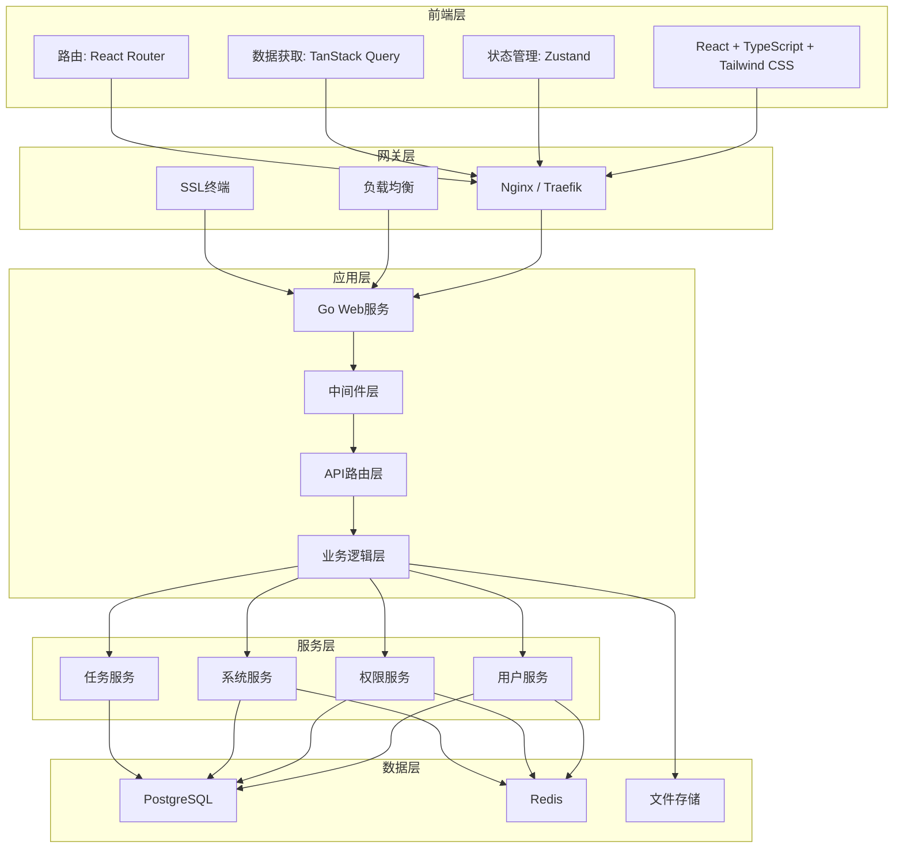
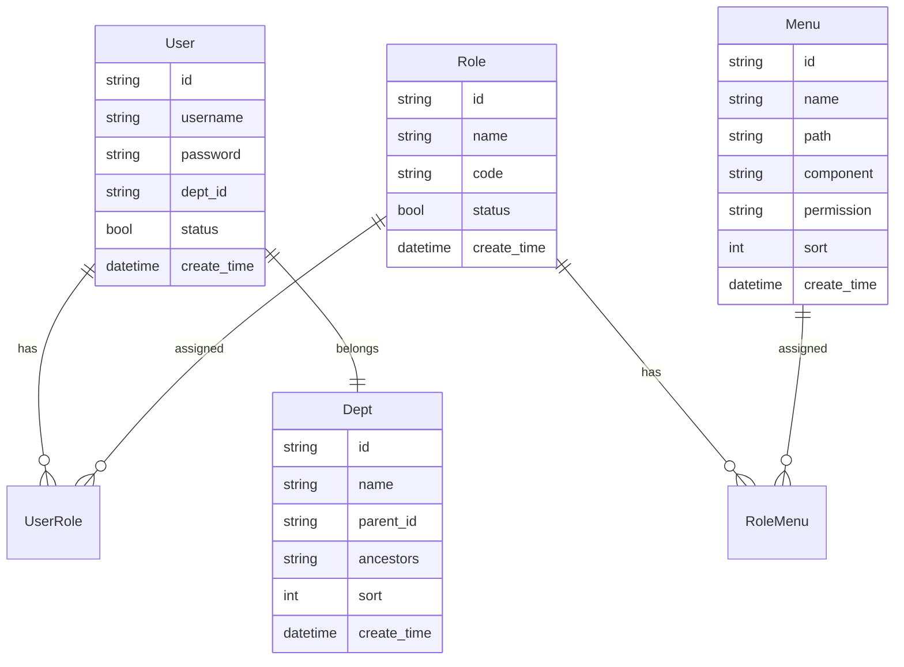

# RuoYi-Next 项目概述和架构设计

## 1. 项目概述

### 1.1 项目背景

本项目是基于若依（RuoYi）开源管理系统的全新重构版本，旨在解决原有系统的技术债务问题，采用现代化的技术栈和架构设计，构建一个高性能、高可用、易扩展的企业级权限管理系统。

### 1.2 项目目标

- **技术现代化**：采用 Go 语言和 React 技术栈，提升系统性能
- **架构优化**：解决原有系统的架构混乱和技术债务问题
- **功能完整**：实现若依系统的所有核心功能
- **安全增强**：集成国密算法，提升系统安全性
- **易于维护**：清晰的代码结构和完善的文档体系

### 1.3 核心功能模块

| 模块名称 | 功能描述 | 主要特性 |
|---------|---------|---------|
| 用户管理 | 用户信息的增删改查、状态管理、权限分配 | 支持批量操作、密码策略、用户导入导出 |
| 部门管理 | 组织机构配置、树形结构展示 | 多级部门、数据权限继承 |
| 岗位管理 | 用户职务配置、岗位权限管理 | 岗位定义、权限绑定 |
| 菜单管理 | 系统菜单配置、操作权限控制 | 动态菜单、按钮级权限控制 |
| 角色管理 | 角色权限分配、数据范围划分 | RBAC模型、灵活的权限组合 |
| 字典管理 | 系统固定数据维护 | 分类管理、缓存优化 |
| 参数管理 | 系统动态参数配置 | 热更新、参数验证 |
| 通知公告 | 系统消息发布管理 | 多类型通知、已读未读状态 |
| 操作日志 | 用户操作记录查询 | 详细日志、统计分析 |
| 登录日志 | 登录行为记录监控 | 异常登录检测、IP追踪 |
| 在线用户 | 当前活跃用户监控 | 实时状态、强制下线 |
| 定时任务 | 任务调度管理 | 可视化配置、执行日志 |
| 代码生成 | 前后端代码自动生成 | 模板定制、一键生成 |
| 系统接口 | API文档自动生成 | Swagger文档、接口测试 |
| 服务监控 | 系统资源监控 | CPU、内存、磁盘监控 |
| 缓存监控 | Redis缓存状态监控 | 缓存统计、性能分析 |
| 在线构建器 | 表单元素可视化构建 | 拖拽式设计、代码生成 |
| 连接池监控 | 数据库连接池监控 | 性能分析、瓶颈识别 |

## 2. 技术架构

### 2.1 整体架构图



### 2.2 技术栈选择

#### 后端技术栈

| 技术 | 版本 | 用途 | 选择理由 |
|------|------|------|---------|
| Go | 1.23+ | 后端开发语言 | 高性能、高并发、简洁语法 |
| Gin | 1.9+ | Web框架 | 轻量级、高性能、丰富的中间件 |
| GORM | 1.25+ | ORM框架 | 功能完善、支持异步、易用 |
| Redis | 7.4+ | 缓存和会话存储 | 高性能、丰富的数据结构 |
| PostgreSQL | 18.1+ | 主数据库 | 强大的功能、事务支持、JSON支持 |
| NATS | 2.10+ | 消息队列 | 轻量级、高性能、云原生 |
| Prometheus | 2.48+ | 监控指标 | 标准化的监控系统 |
| JWT | - | 认证授权 | 无状态、跨语言支持 |

#### 前端技术栈

| 技术 | 版本 | 用途 | 选择理由 |
|------|------|------|---------|
| React | 19.2+ | UI框架 | 生态丰富、组件化开发 |
| TypeScript | 5.9+ | 类型系统 | 类型安全、提升开发效率 |
| Tailwind CSS | 3.4+ | CSS框架 | 原子化CSS、快速开发 |
| Vite | 6.0+ | 构建工具 | 快速的热更新、优化的生产构建 |
| Zustand | 5.0+ | 状态管理 | 轻量级、TypeScript友好 |
| TanStack Query | 5.56+ | 数据获取 | 缓存、重试、乐观更新 |
| React Router | 7.0+ | 路由管理 | 声明式路由、代码分割 |
| Ant Design | 5.21+ | UI组件库 | 企业级组件设计 |
| Node.js | 24.12+ | 构建环境 | LTS版本，长期支持 |

### 2.3 架构设计原则

1. **单一职责原则**：每个模块只负责单一的业务功能
2. **开闭原则**：对扩展开放，对修改封闭
3. **依赖倒置原则**：依赖抽象而非具体实现
4. **接口隔离原则**：使用小而专的接口
5. **领域驱动设计**：以业务领域为核心进行建模

## 3. 系统架构设计

### 3.1 后端架构设计

#### 3.1.1 分层架构

```
┌─────────────────────────────────────────┐
│            API 接口层                   │
│  - HTTP请求处理                         │
│  - 参数验证                             │
│  - 响应封装                             │
└─────────────────────────────────────────┘
┌─────────────────────────────────────────┐
│            中间件层                     │
│  - 认证授权中间件                       │
│  - 日志记录中间件                       │
│  - 限流熔断中间件                       │
│  - 跨域处理中间件                       │
└─────────────────────────────────────────┘
┌─────────────────────────────────────────┐
│            业务逻辑层                   │
│  - 业务规则实现                         │
│  - 事务管理                             │
│  - 领域服务                             │
└─────────────────────────────────────────┘
┌─────────────────────────────────────────┐
│            数据访问层                   │
│  - 数据库操作                           │
│  - 缓存操作                             │
│  - 持久化实现                           │
└─────────────────────────────────────────┘
```

#### 3.1.2 模块划分

```
project/
├── cmd/                    # 应用入口
│   ├── server/            # Web服务
│   └── worker/            # 后台任务
├── internal/              # 内部代码
│   ├── api/               # API层
│   │   ├── v1/           # API v1版本
│   │   └── middleware/   # 中间件
│   ├── service/           # 业务服务层
│   ├── repository/        # 数据访问层
│   ├── model/            # 数据模型
│   ├── domain/           # 领域模型
│   └── infrastructure/    # 基础设施
├── pkg/                   # 公共包
│   ├── cache/            # 缓存封装
│   ├── config/           # 配置管理
│   ├── crypto/           # 加密工具
│   ├── logger/           # 日志工具
│   ├── utils/            # 通用工具
│   └── validator/        # 验证器
├── scripts/              # 脚本文件
└── configs/              # 配置文件
```

### 3.2 前端架构设计

#### 3.2.1 目录结构

```
src/
├── components/          # 通用组件
│   ├── common/         # 基础组件
│   ├── business/       # 业务组件
│   └── layout/         # 布局组件
├── pages/              # 页面组件
│   ├── system/         # 系统管理
│   ├── monitor/        # 系统监控
│   └── tool/           # 系统工具
├── hooks/              # 自定义Hooks
├── services/           # API服务
├── stores/             # 状态管理
├── types/              # TypeScript类型
├── utils/              # 工具函数
├── constants/          # 常量定义
├── routers/            # 路由配置
└── styles/             # 样式文件
```

#### 3.2.2 组件设计模式

1. **容器组件模式**：分离数据获取和UI展示
2. **组合模式**：通过组合小组件构建复杂UI
3. **受控组件模式**：由状态控制组件行为
4. **Render Props模式**：共享组件逻辑

## 4. 核心功能设计

### 4.1 权限管理系统

#### 4.1.1 RBAC模型设计



#### 4.1.2 权限控制流程

1. **登录认证**：用户登录生成JWT Token
2. **权限查询**：根据用户角色查询权限列表
3. **权限缓存**：将用户权限缓存到Redis
4. **请求拦截**：中间件验证每个请求的权限
5. **前端控制**：根据权限动态生成菜单和按钮

### 4.2 缓存系统设计

#### 4.2.1 缓存架构

```
┌─────────────────┐     ┌─────────────────┐
│   应用缓存      │────▶│   Redis集群     │
│   (本地内存)    │     │   (分布式)      │
└─────────────────┘     └─────────────────┘
         │                       │
         │              ┌─────────────────┐
         └─────────────▶│   持久化存储     │
                        │   (PostgreSQL)  │
                        └─────────────────┘
```

#### 4.2.2 缓存策略

| 数据类型 | 缓存策略 | TTL | 更新机制 |
|---------|---------|-----|---------|
| 用户信息 | Write-Through | 30分钟 | 实时更新 |
| 权限数据 | Write-Through | 60分钟 | 权限变更时更新 |
| 字典数据 | Lazy-Loading | 24小时 | 定时刷新 |
| 系统配置 | Write-Behind | 10分钟 | 批量更新 |

### 4.3 日志系统设计

#### 4.3.1 日志分级

- **DEBUG**：调试信息，仅在开发环境使用
- **INFO**：一般信息，记录正常操作
- **WARN**：警告信息，需要关注但不影响运行
- **ERROR**：错误信息，需要立即处理
- **FATAL**：致命错误，导致系统崩溃

#### 4.3.2 日志格式

```json
{
  "timestamp": "2024-01-01T12:00:00Z",
  "level": "INFO",
  "trace_id": "123456789",
  "span_id": "987654321",
  "service": "user-service",
  "module": "auth",
  "user_id": "1001",
  "ip": "192.168.1.100",
  "message": "用户登录成功",
  "extra": {
    "username": "admin",
    "login_type": "password"
  }
}
```

### 4.4 监控系统设计

#### 4.4.1 监控指标

| 监控类型 | 指标名称 | 说明 |
|---------|---------|------|
| 系统指标 | CPU使用率 | 系统CPU占用百分比 |
| 系统指标 | 内存使用率 | 物理内存和虚拟内存使用 |
| 系统指标 | 磁盘使用率 | 磁盘空间占用 |
| 应用指标 | QPS | 每秒请求数 |
| 应用指标 | 响应时间 | 请求平均响应时间 |
| 应用指标 | 错误率 | 错误请求占比 |
| 数据库指标 | 连接池使用率 | 数据库连接使用情况 |
| 数据库指标 | 慢查询数 | 超过阈值的查询数量 |
| 缓存指标 | 命中率 | 缓存命中百分比 |
| 缓存指标 | 操作延迟 | 缓存读写延迟 |

#### 4.4.2 告警规则

- CPU使用率超过80%持续5分钟
- 内存使用率超过90%
- 磁盘使用率超过85%
- API响应时间超过2秒
- 错误率超过5%
- 数据库连接池使用率超过90%
- 缓存命中率低于80%

## 5. 性能优化策略

### 5.1 数据库优化

1. **索引优化**：为常用查询字段添加合适索引
2. **查询优化**：避免N+1查询，使用预加载
3. **连接池**：合理配置连接池参数
4. **读写分离**：主从复制，读写分离
5. **分库分表**：按业务模块分库，大表分表

### 5.2 缓存优化

1. **多级缓存**：本地缓存 + 分布式缓存
2. **缓存预热**：系统启动时预加载热点数据
3. **缓存更新**：合理的缓存失效策略
4. **缓存穿透**：布隆过滤器防止穿透
5. **缓存雪崩**：随机TTL防止雪崩

### 5.3 前端优化

1. **代码分割**：按路由和组件分割代码
2. **懒加载**：组件和图片懒加载
3. **资源压缩**：Gzip压缩，资源合并
4. **CDN加速**：静态资源使用CDN
5. **浏览器缓存**：合理设置缓存策略

## 6. 安全设计

### 6.1 认证安全

1. **国密算法**：使用SM2、SM3、SM4算法
2. **JWT Token**：双Token机制（Access + Refresh）
3. **密码策略**：强密码要求，定期更换
4. **登录保护**：失败锁定，验证码
5. **会话管理**：安全的会话控制

### 6.2 授权安全

1. **细粒度权限**：菜单权限 + 按钮权限
2. **数据权限**：全部、部门、个人数据范围
3. **权限缓存**：权限信息缓存管理
4. **权限审计**：权限变更记录追踪
5. **最小权限原则**：只给必要权限

### 6.3 数据安全

1. **敏感数据加密**：重要字段加密存储
2. **传输加密**：HTTPS/TLS加密
3. **SQL注入防护**：参数化查询
4. **XSS防护**：输入输出过滤
5. **CSRF防护**：Token验证

### 6.4 审计安全

1. **操作日志**：记录所有关键操作
2. **登录日志**：记录登录行为
3. **数据变更**：记录数据修改历史
4. **异常监控**：异常行为检测
5. **合规审计**：满足合规要求

## 7. 项目里程碑

### Phase 1：基础架构搭建（2周）
- [x] 项目初始化和目录结构
- [x] 基础框架搭建
- [x] 数据库设计和创建
- [x] 基础中间件开发

### Phase 2：核心功能开发（4周）
- [ ] 用户管理系统
- [ ] 权限管理系统
- [ ] 菜单管理系统
- [ ] 部门管理系统

### Phase 3：高级功能开发（3周）
- [ ] 系统监控模块
- [ ] 日志管理系统
- [ ] 定时任务模块
- [ ] 缓存管理系统

### Phase 4：系统工具开发（2周）
- [ ] 代码生成器
- [ ] 在线构建器
- [ ] 系统接口文档
- [ ] 性能监控工具

### Phase 5：测试与优化（2周）
- [ ] 单元测试
- [ ] 集成测试
- [ ] 性能优化
- [ ] 安全加固

### Phase 6：部署上线（1周）
- [ ] 部署文档
- [ ] 运维监控
- [ ] 用户培训
- [ ] 项目交付

## 8. 总结

RuoYi-Next项目采用现代化的技术栈和架构设计，旨在打造一个高性能、高可用、易扩展的企业级权限管理系统。通过合理的模块划分、清晰的架构分层、完善的缓存机制和全面的安全设计，该项目能够满足企业级应用的各类需求。

项目重点解决了原有系统的技术债务问题，采用了Go语言的高性能特性、React的现代化前端技术、国密算法的安全保障，以及完整的监控和日志系统，为企业的数字化转型提供坚实的技术支撑。

## 9. 开发规范

为确保项目质量和团队协作效率，所有开发人员必须遵循项目定义的开发规范：

- **《开发规范文档》** - 包含编码规范、状态值规范、数据库设计规范等
- **《后端模型设计文档》** - 定义数据模型和状态值设置规范
- **《前端技术选型和组件设计文档》** - 前端组件设计和状态显示规范
- **《前后端数据结构定义文档》** - API接口和数据类型规范

### 关键规范要点

1. **状态值统一规范**：所有模块状态字段统一使用 0=启用/正常/显示，1=禁用/停用/隐藏
2. **数据库设计规范**：表命名、字段设计、索引创建等统一标准
3. **API设计规范**：RESTful API设计，统一响应格式和错误处理
4. **代码规范**：Go和TypeScript的编码规范和最佳实践
5. **安全规范**：认证授权、数据安全、权限控制等安全标准

严格遵循这些规范将确保项目的：
- 代码一致性和可维护性
- 团队协作效率
- 系统安全性和稳定性
- 开发效率和项目质量

开发规范文档会持续更新，所有团队成员都有责任遵守并参与完善。